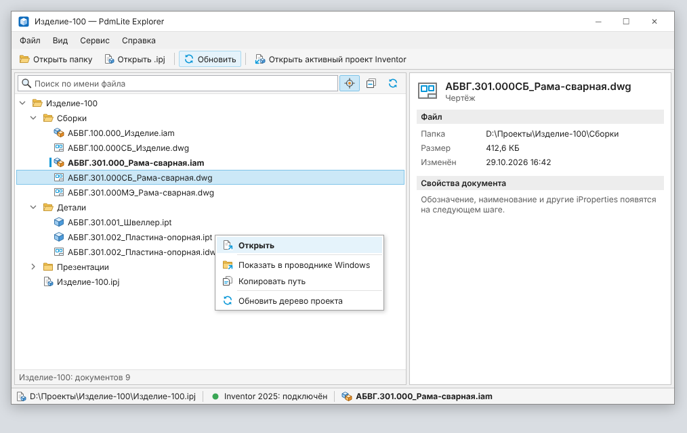
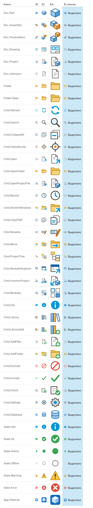

# Стиль оформления PdmLite

Единые правила для плагина в Inventor и для PdmLite Explorer. Цель — интерфейс, который
выглядит как продолжение Inventor: **консервативный, строгий, понятный с первого взгляда**.



*Макет нарисован теми же цветами и иконками, что и тема WPF (`tools/icons/mockup.mjs`).*

## Принципы

1. **Как в Inventor.** Светло-серые панели, белые рабочие области, тонкие серые рамки,
   один синий акцент. Без градиентов, теней и анимаций.
2. **Читаемость важнее декора.** Шрифт Segoe UI 12 px (9 pt, как в Inventor),
   режим отрисовки текста `Display` — чёткий текст на обычных мониторах.
3. **Смысл не только цветом.** Состояние всегда дублируется текстом или формой
   (активный документ — жирный шрифт + синяя метка; связь — иконка + подпись).
4. **Подписи на главных кнопках.** Основные действия — иконка с текстом; на компактных
   панелях — только иконка, но всегда с подсказкой.
5. **Одна тема — везде.** Все цвета и стили берутся из темы; задавать цвета в разметке
   модулей нельзя.

## Подключение темы

Тема — один словарь ресурсов: `PdmLite.UI.Shared/Themes/Theme.xaml`.

| Где | Как |
|---|---|
| Explorer | `App.xaml` подключает `Theme.xaml`; окна — `Style="{StaticResource Pdm.Window}"` |
| Окно плагина в Inventor | `AddInUi` подключает тему к корню окна (`ThemeResources.Create()`) |
| Панель модуля (UserControl) | подключает `Theme.xaml` в своих ресурсах и задаёт стиль `Pdm.Panel` — так панель одинакова в обоих хостах |

## Цвета

| Токен | Цвет | Назначение |
|---|---|---|
| `Pdm.Brush.Window` | `#F0F0F0` | фон окна, промежутки между панелями |
| `Pdm.Brush.Panel` | `#FFFFFF` | рабочие области: дерево, карточка |
| `Pdm.Brush.Toolbar` | `#F5F5F5` | панели инструментов, строки состояния |
| `Pdm.Brush.SectionHeader` | `#EDEDED` | заголовки разделов |
| `Pdm.Brush.Border` | `#C6C6C6` | рамки панелей, разделители групп |
| `Pdm.Brush.Divider` | `#E1E1E1` | внутренние линии |
| `Pdm.Brush.InputBorder` | `#ABADB3` | рамка поля ввода |
| `Pdm.Brush.Text` | `#1E1E1E` | основной текст |
| `Pdm.Brush.TextSecondary` | `#5F5F5F` | подписи полей, пояснения (контраст 6,4 : 1) |
| `Pdm.Brush.TextDisabled` | `#A0A0A0` | недоступные элементы |
| `Pdm.Brush.Accent` | `#0696D7` | фокус, активная вкладка, метка активного документа |
| `Pdm.Brush.Hover` | `#E5F3FB` | наведение |
| `Pdm.Brush.Selected` / `SelectedBorder` | `#CCE8F7` / `#7FC3E8` | выделение (как в браузере Inventor) |
| `Pdm.Brush.SelectedInactive` | `#E4E4E4` | выделение, когда список не в фокусе |
| `Pdm.Brush.Success` / `Warning` / `Error` | `#2E8540` / `#9A6400` / `#C42B1C` | состояния |

## Текст

| Стиль | Применение |
|---|---|
| `Pdm.Text.Title` | имя документа в карточке (15 px, полужирный) |
| `Pdm.Text.Section` | заголовок раздела: серая полоса на всю ширину |
| `Pdm.Text.Label` | подпись поля (серый, слева от значения) |
| `Pdm.Text.Value` | значение поля: только чтение, можно выделить и скопировать |
| `Pdm.Text.Hint` | пояснения, пустые состояния, строка состояния панели |

Правила формулировок:
- Команды — глаголом в инфинитиве: «Открыть», «Обновить», «Копировать путь».
- Многоточие — только если команда открывает диалог: «Открыть папку проекта…».
- Без восклицательных знаков и сленга. Ошибка — что не получилось и почему:
  «Не удалось открыть проект: папка не найдена».
- Только первое слово с заглавной буквы: «Показать в проводнике Windows».

## Элементы управления

| Элемент | Стиль | Правило |
|---|---|---|
| Кнопка диалога | неявный стиль `Button` | серая, рамка 1 px, скругление 2 px; основная (`IsDefault`) — с синей рамкой |
| Кнопка панели инструментов | `Pdm.ToolButton` | плоская; при наведении — голубой фон; включённый переключатель — фон выделения |
| Разделитель групп | `Pdm.ToolSeparator` | вертикальная линия между группами команд |
| Поле ввода | неявный стиль `TextBox` | при фокусе — синяя рамка |
| Поиск | `Pdm.SearchBox` | лупа слева, подсказка в `Tag` |
| Дерево | неявные стили `TreeView`, `TreeViewItem` | шеврон раскрытия, строка 22 px, выделение на всю ширину |
| Вкладки | неявные стили `TabControl`, `TabItem` | плоские, активная — синяя линия снизу |
| Панель инструментов | `Pdm.Toolbar` | полоса `#F5F5F5` с линией снизу |

Размеры: строка списка — 22 px, кнопка — от 24 px, отступы кратны 2 (основные: 4, 6, 10).

## Иконки



- Сетка **16 × 16**, векторные, масштабируются без потерь (32 px — карточка документа и большие
  кнопки ленты Inventor).
- **Стиль — плоский, как Inventor 2025:** светлые заливки, тонкий контур в тон, без градиентов;
  акценты — синий `#0696D7` (действие), оранжевый `#F28A1A` (выделенное, правка), зелёный `#3AA655`
  (добавить, готово), красный `#E04B3A` (исключить, ошибка). Значки-модификаторы (стрелка, «плюс») —
  в правом нижнем углу на белой подложке.
- **Документы Inventor** (`.ipt`, `.iam`, `.idw`, `.dwg`, `.ipn`, `.ipj`) — **свои иконки** в этом стиле, а не
  иконки Windows (Windows показывает значки той версии Inventor, что зарегистрировала расширения, часто старые):
  деталь — синий куб, сборка — синий и оранжевый кубы, чертёж — лист с видами и основной надписью,
  презентация — разнесённые кубы, проект — лист с кубом. Остальные файлы (PDF, STEP…) — иконками Windows,
  как в Проводнике (`ShellIcons`, `FileIconConverter`). Папки — свои.
- **Команды** — тёмно-серые линии и светлые заливки с одним цветным акцентом.
- **Состояния** — зелёный (работает), серый контур (нет связи), жёлтый (предупреждение),
  красный (ошибка).
- Логотипы и знаки Autodesk не используются.

Иконки описаны один раз в `tools/icons/icons.mjs`. После изменения:

```bash
node tools/icons/build.mjs
```

Скрипт обновит `Themes/Icons.xaml`, иконку Explorer (`Assets/PdmLite.ico`) и `docs/images/icons.png`.
В коде иконка задаётся ключом из `IconKeys` (`PdmLite.Core.UI`): `Icon: IconKeys.Refresh` в описании команды
или панели; в XAML — `{StaticResource Pdm.Icon.Cmd.Refresh}`.

На ленте Inventor иконки растеризуются из той же векторной темы (`RibbonIcons`, 16 и 32 px).

## Контекстные меню

Везде, где есть список или дерево с объектами, команды дублируются в меню по правой кнопке:
не нужно тянуться к панели инструментов. Правила:
- правый щелчок выделяет строку или узел под курсором (`ui:RightClickSelect.IsEnabled="True"`);
  по уже выделенной группе — выделение сохраняется, команда относится ко всем выделенным;
- первым и жирным — действие по умолчанию (то же, что двойной щелчок);
- опасные действия («Удалить») — внизу, отделены чертой;
- в меню списков объектов — «Показать файл» и «Копировать обозначение» (`UiClipboard`).

## Панель инструментов и размеры окон

- Панель инструментов окна — `ui:ToolbarPanel` (как лента Inventor): если места не хватает, у кнопок
  со значком справа налево скрывается текст (остаются значок и подсказка); когда текст скрыт у всех —
  панель обрезается. Кнопки без значка текст не теряют. Поле поиска и фильтры — справа, `DockPanel.Dock="Right"`.
- Размеры окон по умолчанию — для большого монитора; стиль `Pdm.Window` уменьшает окно до 95 %
  рабочей области экрана, если оно не помещается (`ui:WindowFit.FitToScreen`).

